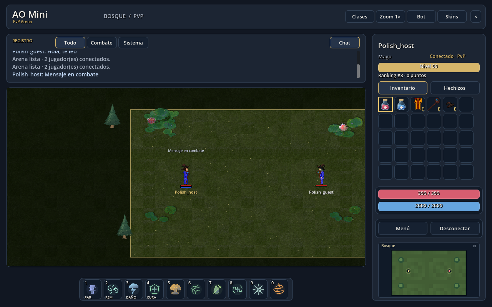

# AO Mini

Arena PvP inspirada en Argentum Online, centrada en duelos rápidos y combate basado en habilidad.

**[Descargar para Windows](https://github.com/1PKure/argentum-godot/releases/download/v0.1.0-alpha.3/AO-Mini-0.1.0-alpha.3-Windows-x64.zip) · [Web](https://ao-mini.pulidomatias.workers.dev) · [Releases](https://github.com/1PKure/argentum-godot/releases)**

## El juego

- Duelos 1 contra 1 con salas, resultados y revancha.
- Práctica contra bot con pausa y reinicio.
- Nueve clases con magia, combate cuerpo a cuerpo y arco.
- Cuatro arenas, skins, chat y ranking.
- Controles configurables y modos clásico o con macros.

## Estado

Versión alpha jugable, con duelos online y práctica local contra bot en Windows.

Para jugar sin internet: descargá el ZIP, descomprimí la carpeta completa y abrí `AO-Mini.exe`. Conectá con la dirección local precargada, creá una sala y agregá un bot.

## Tecnología

Godot 4.7 Standard y GDScript, con clientes web y Windows y servidor dedicado autoritativo mediante WebSocket/WSS.

El código en desarrollo está en [Alpha](https://github.com/1PKure/argentum-godot/tree/Alpha).

## Autoría y créditos

**Matias Pulido · [1PKure](https://github.com/1PKure)**

Recursos de Argentum Online / AO20: Noland Studios y autores originales. El código utiliza [GNU AGPL-3.0](LICENSE); los recursos conservan sus licencias y créditos de origen.
